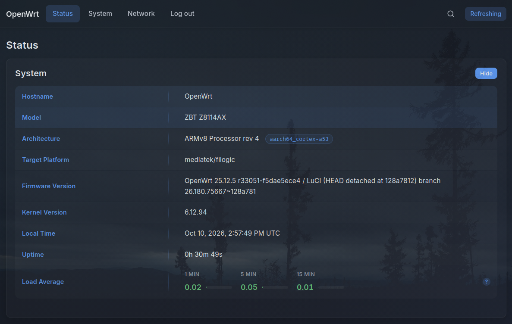

# z8114ax-openwrt
# OpenWrt Support for ZBT Z8114AX-DS

Hi! 👋

This is my **very first time working on OpenWrt device support**, and this repository is where I'll document my journey of bringing OpenWrt support to my ZBT Z8114AX-DS router.

## Screenshot

## Why This Router?

Funny enough, I originally bought this router to use as a travel router. The funny part? I actually hate going outside and don't really travel. 😂

I could have bought a device that already has official OpenWrt support, but I wanted something with specifications closer to my ZBT Z8102AX V2. That's how I ended up discovering the ZBT Z8114AX-DS.

It's compact enough to carry around, has a cool design, and has hardware that makes it an interesting device to experiment with.

Instead of choosing the easy route, I decided to try bringing OpenWrt support to it myself.

## Hardware

- SoC: MediaTek MT7981B
- CPU: 2× ARM Cortex-A53, up to 1.3 GHz
- Wi-Fi: MediaTek MT7976CN
- Wi-Fi: Wi-Fi 6 / 802.11ax
- RAM: 512MB DDR4 (standard)
- RAM: 1GB DDR4 (my unit)
- Flash: 128MB SPI-NAND
- Ethernet: 1× WAN + 1× LAN
- Ethernet switch: MediaTek MT7531
- 5G: 1× M.2 slot
- SIM: 2× Nano-SIM
- Wi-Fi antennas: 2× external
- 5G antennas: 4× external
- MicroSD: 1×
- UART: 3.3V TTL
- USB: 1× USB

## Current Progress

- [x] Identify the SoC
- [x] Collect basic hardware information
- [x] Develop and test the device tree (DTS)
- [x] Verify NAND flash layout and partitions
- [x] Build and test a working OpenWrt image
- [x] Submit device support upstream (eventually!)

## Disclaimer

This is a work in progress and my first attempt at adding support for an OpenWrt device. Some information and changes may be experimental or untested.

I'm learning as I go, documenting my findings, and figuring things out one step at a time.

If you're interested in this device or have any suggestions, feel free to follow along!

Thanks for stopping by! ❤️
